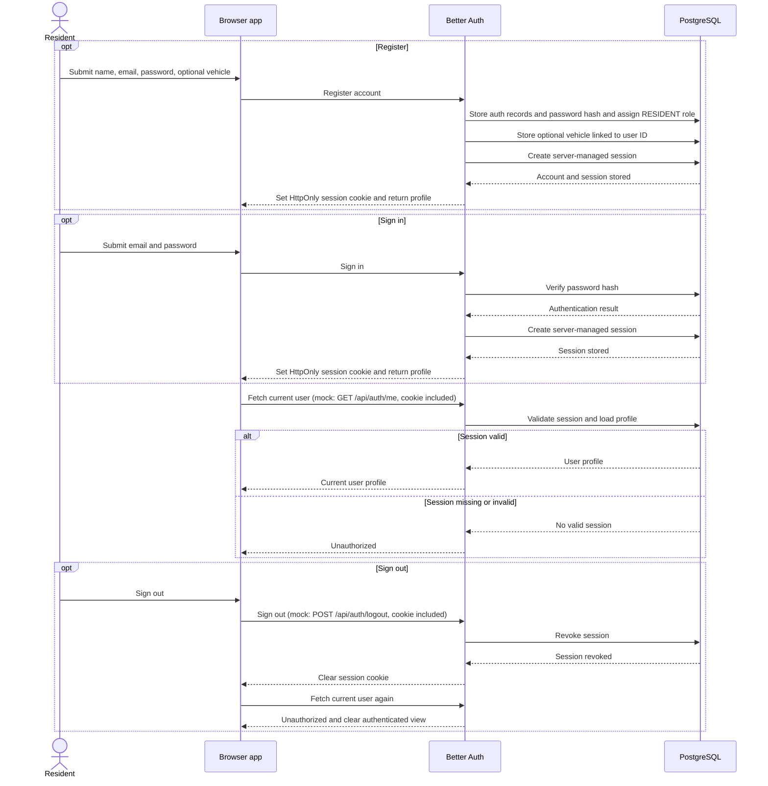
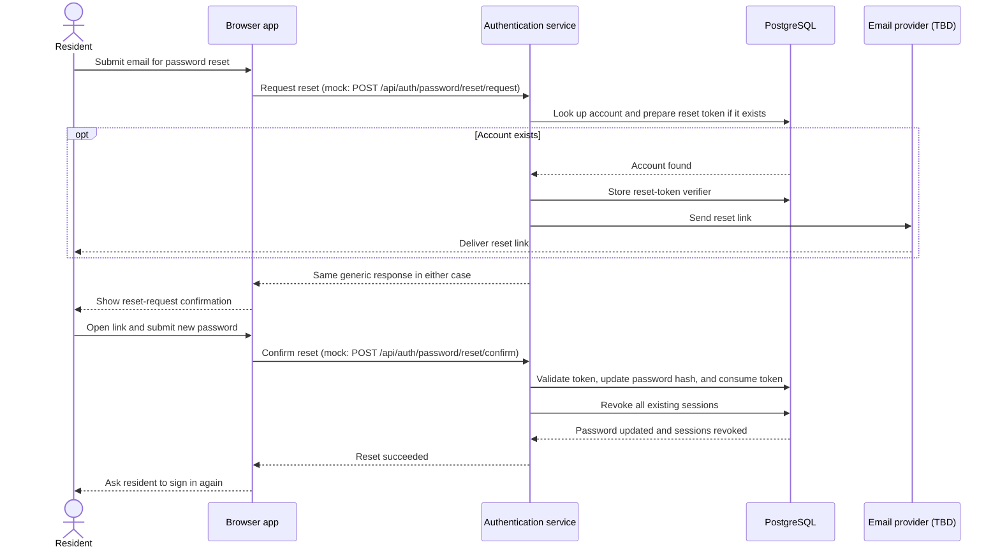
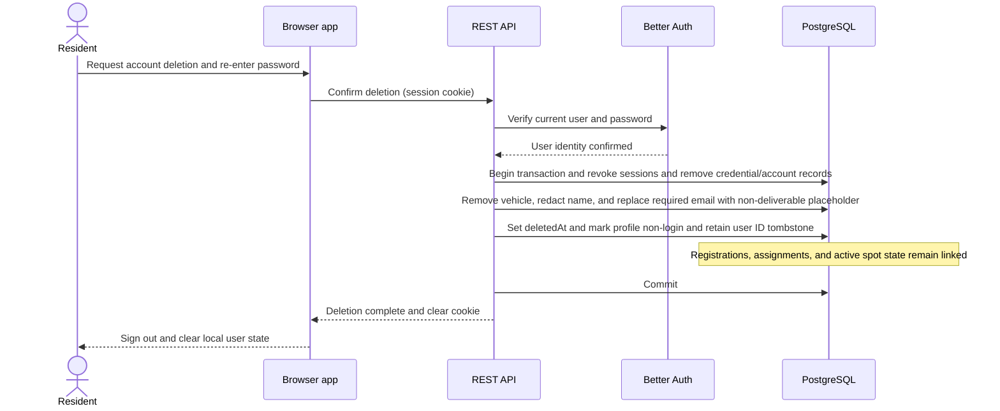
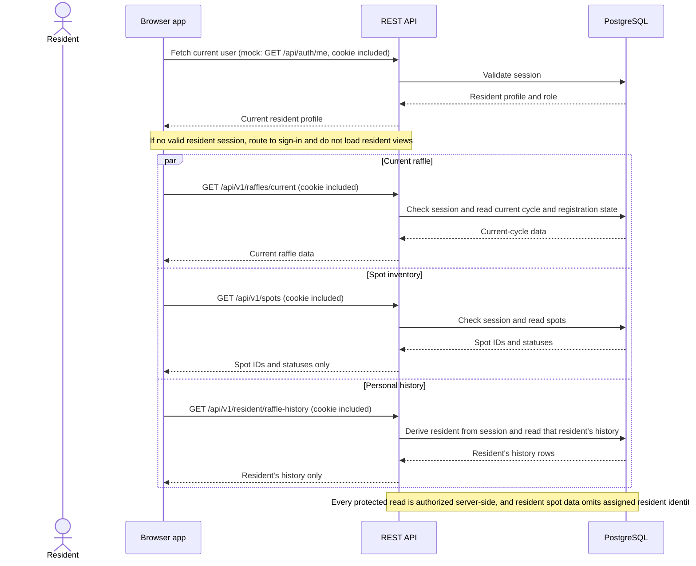
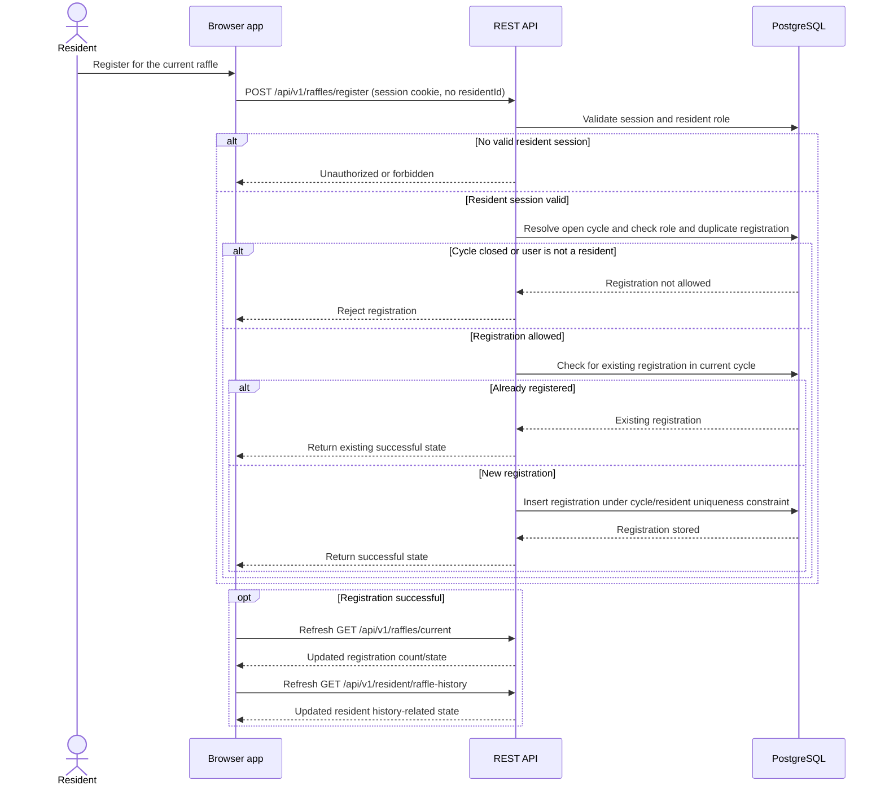
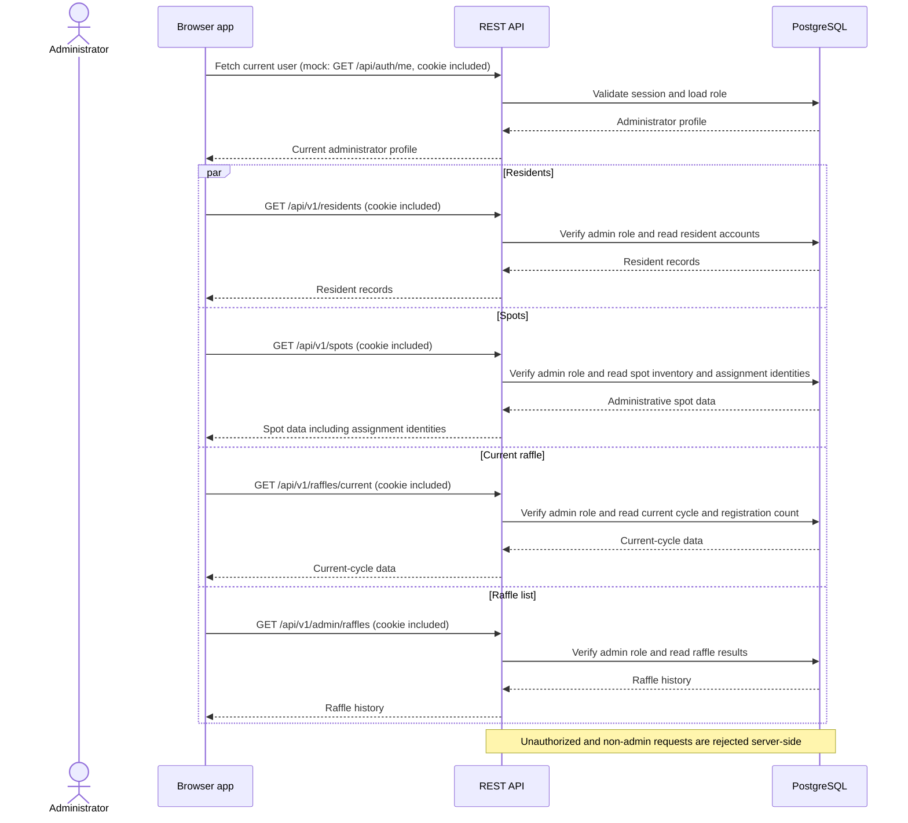
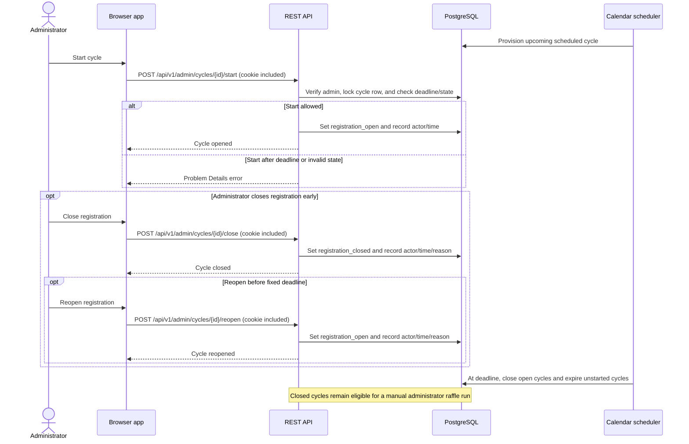
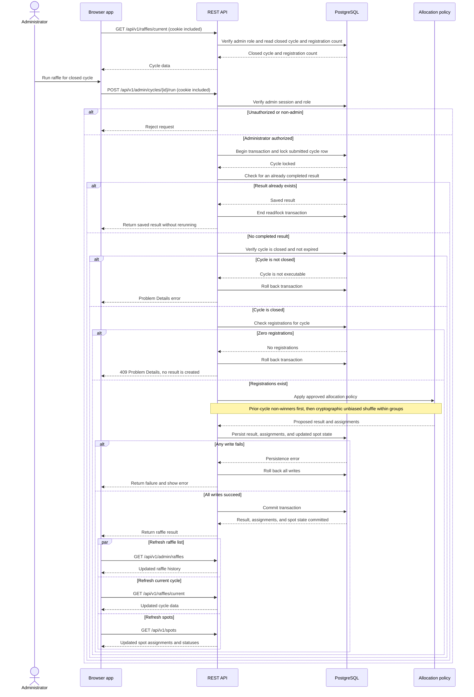

# Community Parking Management System — Data Flow Diagrams

These sequence diagrams describe the agreed production data flows. They complement the [system context](system-context.md) and [container](container-diagram.md) diagrams by showing request order, authorization, persistence, and key failure paths.

Mock paths are labeled as such. Production routes are versioned under `/api/v1`, including Better Auth under `/api/v1/auth`, and errors use RFC 9457 Problem Details. Notes below each diagram call out behavior that the MSW mocks do not yet implement.

## 1. Account and session

Anyone may self-register without administrator approval or mandatory email verification. The server assigns the `RESIDENT` role, and the browser keeps a server-managed session cookie and fetches the current user profile.

**Mock difference:** the login mock sets an `auth_token` cookie and returns a token-shaped JSON field. The registration mock returns a token but does not set a cookie. The mocks do not consistently model the agreed production behavior. Production cookies must be `HttpOnly` and `Secure` with an appropriate `SameSite` policy. Production Better Auth routes use `/api/v1/auth`, and role assignment is server-controlled.

## 2. Password reset

The request response does not reveal whether an account exists. Email delivery depends on an email provider that has not yet been selected. Reset completion revokes existing sessions and requires a fresh sign-in.

**Mock difference:** the MSW reset handlers always return success. The backing mock does not verify a token, change a password, send email, or revoke sessions. The production delivery provider remains to be selected.

## 3. Resident account deletion

The resident confirms deletion by re-entering their password. The API removes login capability and personal details but keeps the user's ID as a tombstone so historical registrations and assignments remain valid. Any active assignment remains in effect through its cycle.

**Data-model note:** Better Auth's hard-delete operation is not used because historical raffle rows reference the user ID. The tombstone cannot authenticate and contains no personal profile data.

## 4. Resident reads

After session restore, the resident dashboard requests the current raffle, spot inventory, and the signed-in resident's history independently in parallel.

**Mock difference:** the history mock derives identity from the cookie, but current-raffle and spot handlers do not enforce a session. The spots mock returns `residentId`, while production resident responses contain only spot IDs and statuses.

## 5. Raffle registration

The API derives the resident from the session and selects the open, upcoming target-quarter cycle. Any `RESIDENT` account may register, with no approved-roster check. Duplicate submissions return the existing successful registration state.

**Mock difference:** the current hook sends `residentId`, and the mock trusts it. Production derives the same user ID from the session instead of trusting the client, while the stored user-to-registration relationship remains unchanged. The mock does not enforce cycle-open status or the database uniqueness constraint.

## 6. Admin dashboard reads

After admin session restore, the dashboard loads its four data sets independently in parallel. Each request is authorized by the API, regardless of the client-side route guard.

**Mock difference:** the current admin route guard checks the role in the browser, but the mock GET handlers do not enforce admin authorization. V1 provides read-only resident and spot views, while roster and spot editing controls are deferred. The dashboard does not currently request raffle-detail retrieval.

## 7. Cycle activation and registration control

The system provisions a scheduled cycle for the upcoming quarter. The administrator starts it to open registration. Registration closes automatically at the fixed target-quarter boundary in `America/Mexico_City`. An administrator may close early or reopen before that deadline. A cycle that was never started expires at the deadline.

Every start, close, reopen, and run action records its actor, action, time, and optional reason. V1 does not automatically execute the raffle.

## 8. Admin raffle execution

The dashboard displays a closed cycle. The API rejects an attempt to run an empty cycle with `409 Conflict` and no result. A retry for a cycle that already completed returns its saved result, as specified in [ADR 0003](../adr/0003-raffle-execution-integrity.md).

**Mock difference:** the current admin page passes a hard-coded cycle, and the mock handler does not enforce admin authorization, cycle lifecycle, empty-registration blocking, or transaction/locking guarantees. Production preserves the mock's previous-cycle non-winner priority but uses a cryptographic unbiased shuffle.
