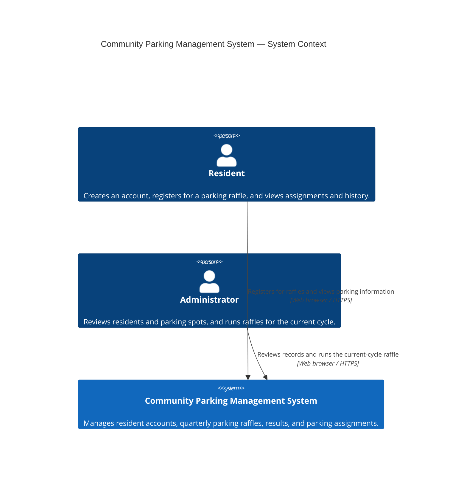

# Community Parking Management System — C4 System Context

The diagram shows the system as a single boundary from each user's perspective. Its web application, API, and database are internal parts of the system and are expanded in the [C4 container diagram](container-diagram.md). External services are omitted until selected; an email provider may be added for password recovery.
